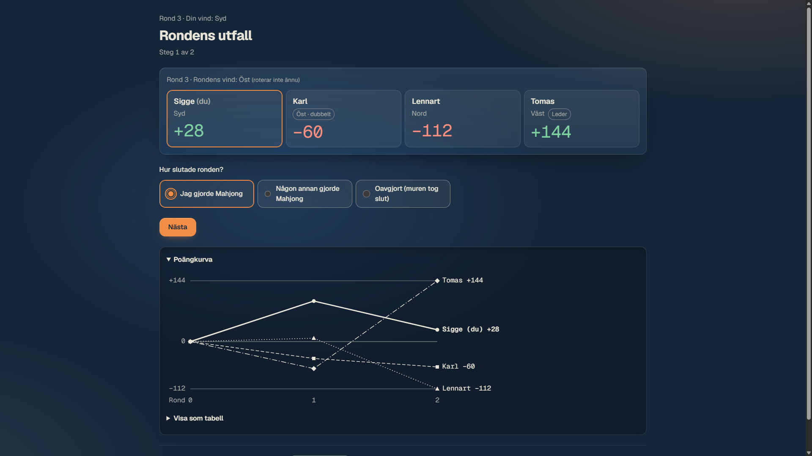

# Mahjong Counter – real-time Mahjong score tracker

Real-time score tracking for Mahjong. Four players join a lobby from their phones using a 6-character code, enter their scores round by round, and everyone sees the standings update instantly.



## Features
- **Lobbies with join codes** – create a game, share a 6-character code, guest login with a nickname (no email, no password)
- **Real-time updates** – every score change is broadcast to all players over WebSockets
- **Two ways to enter scores** – type your own final points, or let the app guide you step by step
- **Score chart** – a live line chart of every player's total round by round, also available as a table
- **Server-side scoring** – payments, totals and wind rotation are all calculated in the backend; the frontend never does the math
- **Reconnect** – reload the page and rejoin your game with the lobby code and nickname
- **Mobile first** – designed for phones from 320px, works on desktop too

## Tech stack
| Layer | Tech |
|---|---|
| Frontend | React 19, TypeScript, Vite, Vitest |
| Backend | Python, FastAPI, WebSockets, pytest |
| Storage | In-memory `GameStore` (no database – see design decisions) |
| Deployment | Single Docker image on Railway – FastAPI serves `/api`, `/ws` and the built frontend |

## Architecture
```
 Phones (browser)  ──HTTP /api──▶  FastAPI  ──▶  GameStore (in memory)
        ▲                            │
        └──────── WebSocket /ws ◀────┘   (broadcast to every player in the lobby)
```

## Design decisions
- **No database.** Games are short-lived sessions, so state lives in memory behind a small `GameStore` interface. This keeps hosting simple and cheap; the interface makes it easy to swap in persistent storage later. Trade-off: a restart clears ongoing games, and the app runs as a single instance.
- **All scoring in the backend.** Mahjong scoring is easy to get wrong, so it lives in one place and is covered by unit tests.
- **One Docker service.** Frontend and backend ship as one image, which avoids CORS and separate deploys.

## Running locally
```bash
# Backend
cd backend
python -m venv .venv && source .venv/bin/activate   # Windows: .venv\Scripts\activate
pip install -r requirements.txt
uvicorn app.main:app --reload

# Frontend (in a new terminal)
cd frontend
npm install
npm run dev
```

Or with Docker:
```bash
docker build -t mahjong-counter .
docker run -p 8000:8000 mahjong-counter
```

## Tests
```bash
cd backend && pytest        # ~70 tests: scoring, game store, API
cd frontend && npm test     # ~50 tests (Vitest)
```

## How it was built
Developed in small, planned steps (see [`docs/faser.md`](docs/faser.md)) on feature branches with pull requests and conventional commits. Game rules, data model and WebSocket events are documented in [`docs/`](docs/). Built with AI-assisted development using Claude Code, with every change reviewed and tested.
